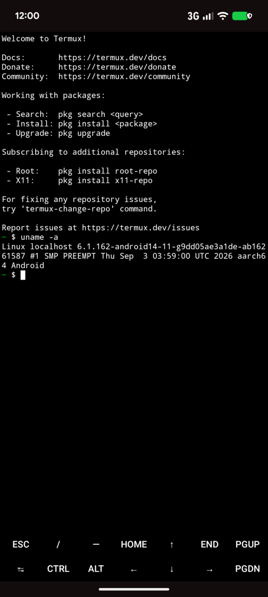
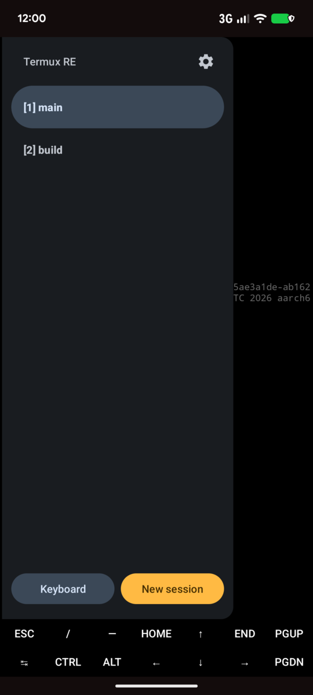
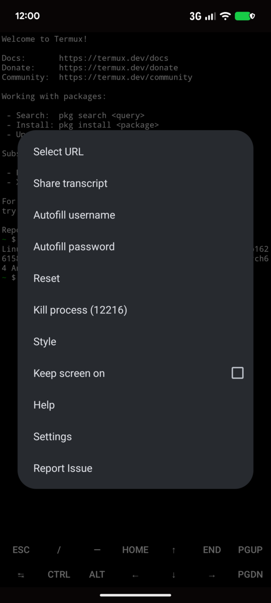
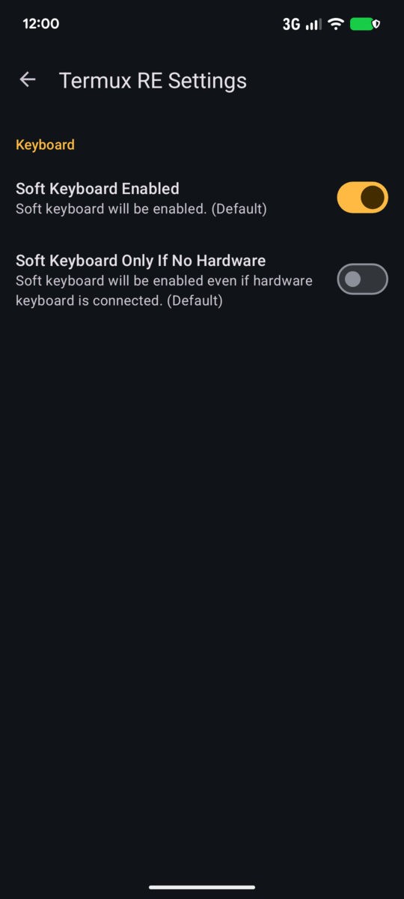
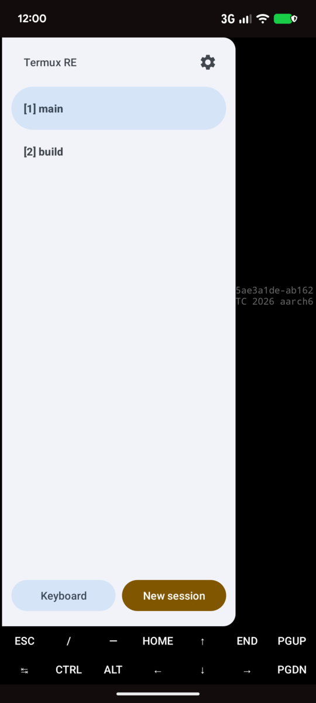
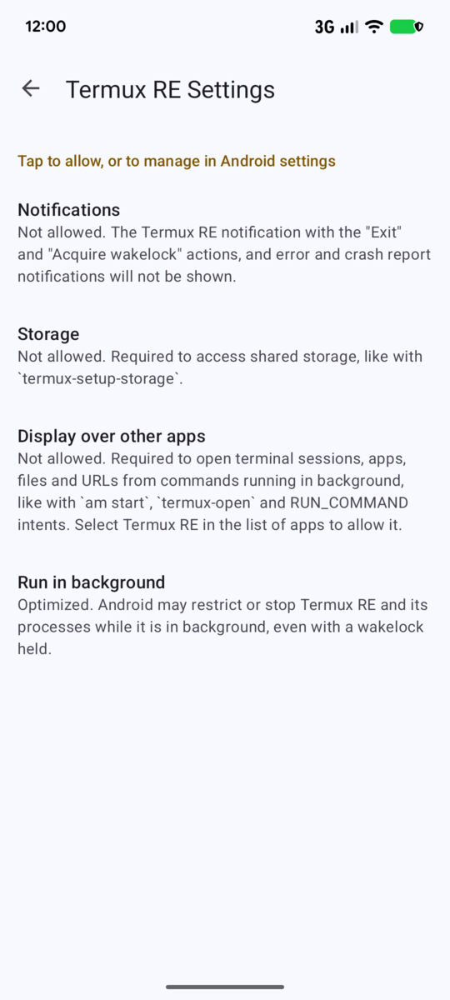
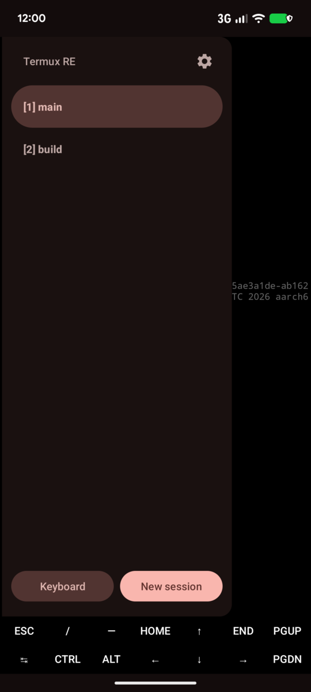
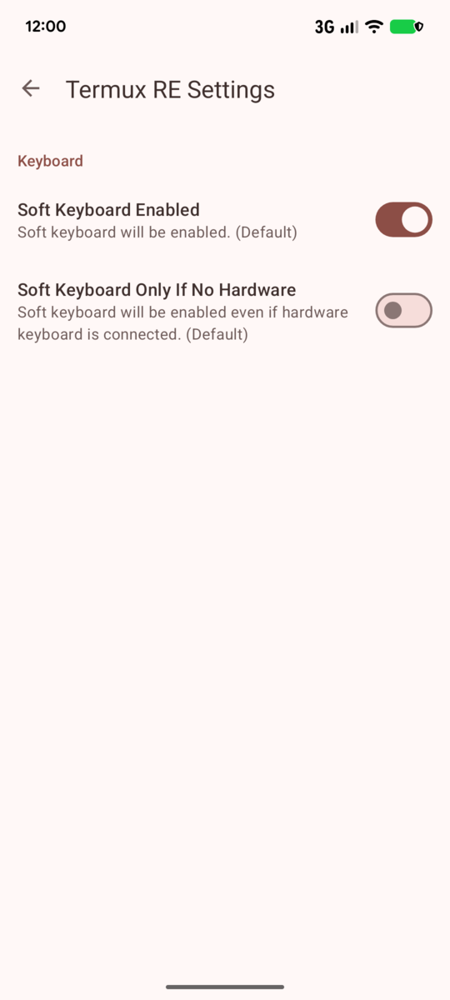

<p align="center">
  
</p>

<h1 align="center">Termux RE</h1>

<p align="center">
  A fork of the <a href="https://github.com/termux/termux-app">Termux</a> terminal emulator and Linux environment for Android that installs next to the official app.
</p>

***

Termux RE is the [Termux app](https://github.com/termux/termux-app) (the user interface and terminal emulation) built under its own package name, `com.termux.re`, with an updated toolchain. It is an unofficial fork and is not affiliated with or endorsed by the Termux project. Report problems with Termux RE [here](https://github.com/riyadmondol2006/termux-app-RE/issues), not upstream.

If you want the official app, install Termux from one of the sources in the [upstream README](https://github.com/termux/termux-app#installation).

## Contents

- [Screenshots](#screenshots)
- [Differences from Termux](#differences-from-termux)
- [Packages and the bootstrap](#packages-and-the-bootstrap)
- [Installation](#installation)
- [Plugins](#plugins)
- [Android 12+ phantom process killer](#android-12-phantom-process-killer)
- [Building](#building)
- [Native code](#native-code)
- [Debugging and reporting issues](#debugging-and-reporting-issues)
- [Contributing](#contributing)
- [Credits](#credits)
- [License](#license)

## Screenshots

The drawer, settings and dialogs use Material 3. The terminal keeps its own colors.

| Terminal | Sessions | Terminal menu | Settings |
| :---: | :---: | :---: | :---: |
|  |  |  |  |

The amber and slate colors of the icon are used on Android 11 and older, and when `dynamic-colors = false` is set. On Android 12+ the app uses Material You colors from the wallpaper by default:

| Light theme | Permissions | Material You, dark | Material You, light |
| :---: | :---: | :---: | :---: |
|  |  |  |  |

## Differences from Termux

- **App name and package.** The app is called Termux RE and its default package name is `com.termux.re`, so it installs side by side with official Termux. Its files live in `/data/data/com.termux.re/files`, separate from Termux's. The package name is a single Gradle property, `termuxPackageName` in `gradle.properties`.
- **Android 7.0+ only** (minSdk 24). Only the `apt-android-7` bootstrap variant is built. The old `apt-android-5` variant was dropped: on current Android its APKs only showed the error that the bootstrap variant is not compatible with the Android version.
- **Toolchain:** compileSdk 37, Android Gradle Plugin 9.5, Gradle 9.9, NDK r30 and Java 17. The JNI libraries are written in Rust (see [Native code](#native-code)).
- **targetSdk stays at 28 on purpose.** With targetSdk 29 or higher, Android blocks executing files from the app's data directory (W^X), which Termux depends on: every program under `$PREFIX` is run from there. As a result, Termux RE can't be published on Google Play, which requires a much higher targetSdk.
- **CI** builds and tests on every push, signs release APKs with your own key, publishes tagged versions as releases, and builds bootstraps and an apt package repository for the fork's package name.
- **New icon**, so you can tell it apart from Termux on the home screen.
- **Material 3 Expressive UI** for the drawer, settings and dialogs, with Material You dynamic colors on Android 12+ (set `dynamic-colors = false` in `~/.termux/termux.properties` for the fixed amber and slate scheme of the icon). The terminal keeps its own colors from `colors.properties`.
- **Update notices.** Release builds check this repository's GitHub releases once a day and offer the APK for the device when a newer version is out (*Settings → Check for updates*). See [Updating and uninstalling](#updating-and-uninstalling).
- **Permissions screen** under *Settings → Termux → Permissions* for the permissions Android 13+ makes easy to lose: notifications (the session notification with *Exit* and *Acquire wakelock*), *Display over other apps* (needed for `am start`/`termux-open` from the background), running in the background, and file access. If storage access was denied permanently, `termux-setup-storage` now explains how to grant it from App info.
- **Bug fixes** for open upstream issues, listed below.

### Fixed upstream issues

| Area | Issues |
| --- | --- |
| Crashes | Pasting only escape/C1 characters ([#5119](https://github.com/termux/termux-app/issues/5119), [#4619](https://github.com/termux/termux-app/issues/4619)), lone UTF-16 surrogates from keyboards ([#3242](https://github.com/termux/termux-app/issues/3242)), sharing text with a very long title ([#4542](https://github.com/termux/termux-app/issues/4542)), session list `IllegalStateException` ([#5027](https://github.com/termux/termux-app/issues/5027), [#4706](https://github.com/termux/termux-app/issues/4706), [#4725](https://github.com/termux/termux-app/issues/4725)), out of memory on rotation with a large scrollback ([#3541](https://github.com/termux/termux-app/issues/3541)), documents provider abort on non-UTF-8 file names ([#3348](https://github.com/termux/termux-app/issues/3348)), crash report notification failures ([#5145](https://github.com/termux/termux-app/issues/5145)) |
| Freezes | Main thread blocked (ANR) by large pastes ([#5379](https://github.com/termux/termux-app/issues/5379)), bootstrap install failing when the activity is recreated during it, e.g. on MIUI/HyperOS ([#5172](https://github.com/termux/termux-app/issues/5172)) |
| Keyboard | Ctrl+Alt and AltGr combinations swallowed ([#5240](https://github.com/termux/termux-app/issues/5240), [#3412](https://github.com/termux/termux-app/issues/3412), [#2585](https://github.com/termux/termux-app/issues/2585), [#161](https://github.com/termux/termux-app/issues/161)), modifier keys clearing latched extra keys ([#1620](https://github.com/termux/termux-app/issues/1620)), Ctrl+@ and Ctrl+? ([#3896](https://github.com/termux/termux-app/issues/3896)), Print Screen ([#5365](https://github.com/termux/termux-app/issues/5365)), extra keys auto-repeat off the main thread ([#2156](https://github.com/termux/termux-app/issues/2156)) |
| Terminal | Right/middle mouse buttons under mouse tracking ([#5237](https://github.com/termux/termux-app/issues/5237)), focus reporting with DECSET 1004 ([#3650](https://github.com/termux/termux-app/issues/3650)), OSC 52 clipboard copies over 16 KB being cut off, background color from `colors.properties` ignored when started from a widget or url-opener ([#4849](https://github.com/termux/termux-app/issues/4849), [#4420](https://github.com/termux/termux-app/issues/4420)), toast flood from title changes of background sessions ([#5088](https://github.com/termux/termux-app/issues/5088), plus a `disable-terminal-session-title-change-toast` property) |
| Processes | Programs surviving the exit of their session because `SIGHUP` was inherited as ignored ([#935](https://github.com/termux/termux-app/issues/935)), JNI error handling ([#5254](https://github.com/termux/termux-app/issues/5254)), `getprop` process leak ([#5144](https://github.com/termux/termux-app/issues/5144)), `termux-am` socket sending a second result after a failed command |

## Packages and the bootstrap

**Read this before installing a `com.termux.re` build.**

Termux packages are compiled with their install prefix hardcoded: `/data/data/<package name>/files/usr`. It appears in binaries, scripts, shebangs and configuration files, and can't be changed after the fact. The *bootstrap* is the minimal set of packages (shell, coreutils, `apt`, …) that the app embeds and extracts on first launch. That has these consequences:

- The official bootstrap and the official package repositories only work in an app whose package name is `com.termux`. Packages from them don't work in Termux RE, and packages built for Termux RE don't work in Termux.
- A `com.termux.re` build needs bootstrap archives built for `com.termux.re`. This repository's *Build bootstraps* workflow ([`build_bootstraps.yml`](.github/workflows/build_bootstraps.yml)) makes them and publishes them on this repository's GitHub Pages site, next to the package repository, as `https://riyadmondol2006.github.io/termux-app-RE/bootstrap/<id>/bootstrap-<arch>.zip` with a `SHA256SUMS` file signed with the repository key; [`bootstrap/latest`](https://riyadmondol2006.github.io/termux-app-RE/bootstrap/latest) holds the newest id, and the two newest are kept. Start it by hand from the Actions tab. It builds the bootstrap packages from source with [termux-packages](https://github.com/termux/termux-packages), publishes them in the Termux RE package repository (below), and then assembles the bootstrap from that repository with termux-packages' `generate-bootstraps.sh`, like the official bootstraps, so it has the same packages as the repository, without build dependencies. That takes about an hour; with *source* set to `repository` it skips the build and takes minutes. Every archive is checked with [`apt-repo/check-bootstrap.py`](apt-repo/check-bootstrap.py) and compared with the official bootstrap in the job summary. After that, every CI build embeds the newest bootstrap automatically, after checking the signature of its `SHA256SUMS`.
- Until then, builds embed the official bootstrap. A `com.termux.re` build then doesn't extract it (its programs couldn't run), but explains why on first launch and offers a failsafe session running Android's `/system/bin/sh`.
- `pkg install` needs an apt repository of packages built for `com.termux.re`. Termux RE has one, see below.

### The Termux RE package repository

Termux RE has its own apt repository of packages built for `com.termux.re`, hosted on this repository's GitHub Pages site:

```
deb https://riyadmondol2006.github.io/termux-app-RE/apt/termux-main stable main
```

[The site](https://riyadmondol2006.github.io/termux-app-RE/) lists the packages it has. It starts with the bootstrap packages and a set of everyday tools ([`apt-repo/packages.txt`](apt-repo/packages.txt)): Python with pip, Node.js, git, OpenSSH, rsync, vim, zsh, tmux, htop, curl, wget, zip, jq, make, man pages, proot and proot-distro, plus everything they depend on. proot-distro runs full Debian, Ubuntu, Arch or Alpine environments with their own package managers, a way to get software that isn't in this repository.

Termux RE's bootstrap is set up to use it, so `pkg install python` just works:

- `$PREFIX/etc/apt/sources.list` points at it.
- Its signing key is installed by the `termux-keyring` package and trusted by apt. The key's fingerprint is `4F9F 3AF3 6023 DC4C 4E24 E464 3F73 0223 6E98 D269`, its public part is [`apt-repo/termux-re.asc`](apt-repo/termux-re.asc). The repository is signed in CI with the private key in the `APT_SIGNING_KEY` repository secret.
- Every mirror that `pkg` and `termux-change-repo` can choose from (`$PREFIX/etc/termux/mirrors`) points at it, so mirror selection never switches to the official repositories.

The repository also has the `apt`, `termux-keyring` and `termux-tools` packages built with these settings, so upgrading them keeps them. The changes are made by [`apt-repo/patch-termux-packages.sh`](apt-repo/patch-termux-packages.sh) in the termux-packages checkout that the *Build bootstraps* and *Build packages* workflows build from.

#### Adding packages

Run the *Build packages* workflow ([`build_packages.yml`](.github/workflows/build_packages.yml)) from the Actions tab with the termux-packages names of the packages, separated by spaces, for example `neovim ruby`. Without a list it builds `apt-repo/packages.txt`; add packages there to keep them in the default set. The workflow:

- Builds for each architecture (`aarch64`, `arm`, `i686`, `x86_64`, choose with the *architectures* input) from termux-packages `master` or the ref you give.
- Builds the dependencies too. Those that the repository already has in the version termux-packages wants are downloaded from it instead (`build-package.sh -I`), and requested packages that it already has in their current version are skipped. Running it again after termux-packages updated a package only builds what changed. *force* rebuilds anyway.
- Accepts subpackage names and builds them through their package (`curl` through `libcurl`).
- Publishes the result with the *Publish packages* workflow ([`publish_packages.yml`](.github/workflows/publish_packages.yml)), which merges it into the published repository, keeps the newest version of each package, signs and deploys it. The Build bootstraps workflow publishes the bootstrap packages it builds the same way. To remove a package, run *Publish packages* with its name in *remove*.

#### Limits

- **6 hours per architecture and run.** GitHub stops jobs after 6 hours, and each architecture builds its whole list in one job. Packages that are not started in time are listed in the job summary; run the workflow again for them, everything already published is skipped. The first run has to build every dependency from source.
- **Toolchains are out of reach.** `clang`/LLVM, `rust` and similar toolchains take longer than 6 hours to build from source on GitHub's runners, so they are not in the repository, and neither is anything that needs them to build. Programs that compile code on the device (`pip install` of packages with C extensions, `npm` packages with native addons) need `clang` and won't work.
- **1 GB.** GitHub Pages sites are limited to 1 GB. The repository has all four architectures, the Publish packages workflow refuses to deploy more than 950 MiB.
- **Main packages only.** Packages from termux-packages' `x11-packages` and `root-packages` directories are not supported.
- **Versions** come from termux-packages at the time of the build and can be ahead of or behind the official repositories.
- **command-not-found** suggests the packages of this repository that provide a missing command, as listed in its `Contents-<arch>.gz` files when `command-not-found` was built. A build made before the repository had those files suggests the packages of the official Termux repository instead, and `pkg install` fails for those that are not here yet.
- Right after a publish, GitHub Pages can serve the old index for up to 10 minutes; `pkg update` may report a hash mismatch until then.

To host the repository in a fork: generate a signing key (`gpg --quick-gen-key "<name>" rsa4096 sign never`), replace `apt-repo/termux-re.gpg` and `apt-repo/termux-re.asc` with its public key, store the ASCII armored private key in the `APT_SIGNING_KEY` secret, enable GitHub Pages with *GitHub Actions* as the source, then run *Build packages* and *Build bootstraps*.

#### Building locally

To build bootstraps or packages yourself, configure a termux-packages checkout with the same scripts and build with its Docker image. [`apt-repo/fix-termux-packages.sh`](apt-repo/fix-termux-packages.sh) works around build problems: a bootstrap package that is now a subpackage, and source downloads from git.kernel.org, which often time out from GitHub's runners (the workflows also retry builds that failed to download sources).

```sh
git clone https://github.com/termux/termux-packages.git
apt-repo/fix-termux-packages.sh termux-packages
apt-repo/patch-termux-packages.sh termux-packages com.termux.re https://riyadmondol2006.github.io/termux-app-RE/apt/termux-main https://github.com/riyadmondol2006/termux-app-RE
cd termux-packages
./scripts/run-docker.sh ./scripts/build-bootstraps.sh --architectures aarch64
./scripts/run-docker.sh ./build-package.sh -a aarch64 python
```

See [Building packages](https://github.com/termux/termux-packages/wiki/Building-packages) for more. The built `.deb` files are in `termux-packages/output`; install one in Termux RE with `apt install ./<file>.deb`.

If you need the official repositories instead, build with `-PtermuxPackageName=com.termux` (see [Building](#building)). That build uses the official bootstraps and repositories, but it can't be installed next to official Termux: it has the same package name and a different signing key.

## Installation

Requirements: Android 7.0 or newer.

- **Releases:** signed release APKs are published on [GitHub Releases](https://github.com/riyadmondol2006/termux-app-RE/releases). See [Releases](#releases) for how they are made.
- **Every push:** release and debug APKs are uploaded under *Artifacts* on the run in [GitHub Actions](https://github.com/riyadmondol2006/termux-app-RE/actions); you must be logged into GitHub to download them. Release APKs are signed with the fork's release key. Debug APKs are signed with the publicly known test key `app/testkey_untrusted.jks` inherited from upstream. Anyone can sign an APK with that key and it will install as an update over a debug build, so only install debug APKs that come from this repository.

### Which APK to download

APKs are split by CPU architecture (ABI), plus one universal APK that contains all of them:

| APK file ends in | Use it on |
| --- | --- |
| `_arm64-v8a.apk` | Nearly all current phones and tablets. **Pick this one if unsure.** |
| `_armeabi-v7a.apk` | Older 32-bit ARM devices, and devices that run 32-bit Android on a 64-bit CPU |
| `_x86_64.apk` | 64-bit x86 emulators and Chromebooks |
| `_x86.apk` | 32-bit x86 emulators |
| `_universal.apk` | Any device. It is larger because it contains every ABI. |

To check a device's ABI, run `adb shell getprop ro.product.cpu.abi`.

### Updating and uninstalling

Release builds check for a new release when the terminal is opened, at most once a day, and show a dialog with the release notes. *Download* opens the release APK for the device's ABI in the browser; install it to update. *Skip* hides the notice for that version until the next release. The check only requests this repository's release list from the GitHub API, with the app name and version as the user agent, and sends nothing else. Turn it off, or check right away, under *Settings → Check for updates*. Debug builds only check when you ask, since release APKs can't be installed over them.

Android only installs an update that is signed with the same key as the installed app. Release and debug builds use different keys, so to switch between them you have to uninstall first, which deletes the app's data. [Back up](https://wiki.termux.com/wiki/Backing_up_Termux) your home directory before you uninstall. Uninstalling Termux RE doesn't affect an installed official Termux, and the other way round.

## Plugins

The official plugin apps (Termux:API, Termux:Boot, Termux:Float, Termux:Styling, Termux:Tasker, Termux:Widget) don't work with Termux RE. Each plugin uses the `sharedUserId` `com.termux`, talks to the `com.termux` package, and must be signed with the same key as the main app. Using them would mean rebuilding each plugin for your package name and signing it with your key.

## Android 12+ phantom process killer

Android 12 and later kill "phantom" processes (child processes of apps) when there are more than 32 of them across all apps, and also kill processes that use a lot of CPU in the background. In Termux RE this shows up as `[Process completed (signal 9) - press Enter]` without you exiting the shell. To turn this off:

- **Android 14 and later:** Settings → Developer options → enable **Disable child process restrictions**.
- **Android 12 and 13:** run these from a computer over [adb](https://developer.android.com/tools/adb):

  ```sh
  adb shell "/system/bin/device_config set_sync_disabled_for_tests persistent"
  adb shell "/system/bin/device_config put activity_manager max_phantom_processes 2147483647"
  ```

  On Android 12L and 13 you can also run `adb shell settings put global settings_enable_monitor_phantom_procs false`.

These settings can be reset by system updates. For background, see upstream issue [#2366](https://github.com/termux/termux-app/issues/2366) and [Phantom, cached and empty processes](https://github.com/agnostic-apollo/Android-Docs/blob/master/en/docs/apps/processes/phantom-cached-and-empty-processes.md).

## Building

You need:

- JDK 17 or newer (CI uses JDK 21).
- The Android SDK with platform 37.
- The NDK version set as `ndkVersion` in `gradle.properties` (r30).
- Rust, installed with [rustup](https://rustup.rs). Run `rustup toolchain install` in the repository root to install the toolchain version and Android targets pinned in [`rust-toolchain.toml`](rust-toolchain.toml).

Gradle is provided by the wrapper.

```sh
git clone https://github.com/riyadmondol2006/termux-app-RE.git
cd termux-app-RE
./gradlew assembleDebug
```

The APKs are written to `app/build/outputs/apk/debug/`.

The app's identity and bootstrap are set with Gradle properties, either in `gradle.properties` or with `-P` on the command line:

| Property | Default | Meaning |
| --- | --- | --- |
| `termuxPackageName` | `com.termux.re` | Android package name (`applicationId`). The Java namespace stays `com.termux`. |
| `termuxAppName` | `Termux RE` | App name shown in the launcher and the UI |
| `termuxGithubRepoUrl` | this repository | Linked from the app's about and issue report screens |
| `termuxDonateUrl` | `termuxGithubRepoUrl` | Opened by *Settings → Donate*. Set it to your donation page. |
| `termuxBootstrapUrl` | unset | Where to download `bootstrap-<arch>.zip` and `SHA256SUMS` from, for example `https://riyadmondol2006.github.io/termux-app-RE/bootstrap/<id>`, see [Packages and the bootstrap](#packages-and-the-bootstrap). Unset means the official bootstrap. The `TERMUX_BOOTSTRAP_URL` environment variable works too. |

For example, to build a stock-identity app that works with the official bootstrap and repositories:

```sh
./gradlew assembleDebug -PtermuxPackageName=com.termux -PtermuxAppName=Termux
```

The build detects which package name the embedded bootstrap was built for and warns if it differs from `termuxPackageName` (see [Packages and the bootstrap](#packages-and-the-bootstrap)).

To sign release builds locally, pass the keystore with the `termuxReleaseKeystoreFile`, `termuxReleaseKeystorePassword`, `termuxReleaseKeyAlias` and `termuxReleaseKeyPassword` properties (for example in `~/.gradle/gradle.properties`), or the matching `TERMUX_RELEASE_KEYSTORE_FILE`, `TERMUX_RELEASE_KEYSTORE_PASSWORD`, `TERMUX_RELEASE_KEY_ALIAS` and `TERMUX_RELEASE_KEY_PASSWORD` environment variables. Without them, `assembleRelease` produces unsigned APKs.

### CI and release signing

GitHub Actions runs the unit tests and builds release and debug APKs on every push and pull request ([`build.yml`](.github/workflows/build.yml)). Releases are published by the same workflow, see [Releases](#releases). Release APKs are signed with a keystore that is stored in four repository secrets; without them (for example in pull requests from forks) release APKs are unsigned and tags are not published:

| Secret | Value |
| --- | --- |
| `KEYSTORE_BASE64` | The keystore file, base64 encoded on a single line |
| `KEYSTORE_PASSWORD` | The keystore password |
| `KEY_ALIAS` | The key alias, e.g. `termux-re` |
| `KEY_PASSWORD` | The key password |

To create a keystore and encode it:

```sh
keytool -genkeypair -v -keystore termux-re-release.jks -alias termux-re \
    -keyalg RSA -keysize 4096 -validity 10000

base64 -w 0 termux-re-release.jks > termux-re-release.jks.b64     # Linux
base64 -i termux-re-release.jks -o termux-re-release.jks.b64      # macOS
```

`keytool` creates a PKCS12 keystore by default, and in a PKCS12 keystore the key password is the keystore password, so use the same value for `KEY_PASSWORD` and `KEYSTORE_PASSWORD`. Add the secrets under *Settings → Secrets and variables → Actions*, or with the GitHub CLI:

```sh
gh secret set KEYSTORE_BASE64 < termux-re-release.jks.b64
gh secret set KEYSTORE_PASSWORD
gh secret set KEY_ALIAS --body termux-re
gh secret set KEY_PASSWORD
```

Keep the keystore and its password backed up somewhere safe, and never commit them. If you lose the key, users can't update to your new builds without uninstalling first.

### Releases

The app version comes from git tags, so it never has to be edited by hand:

- A release is the tag `v<major>.<minor>.<patch>` (or `v<major>.<minor>.<patch>-<prerelease>`, published as a pre-release).
- Builds of a tagged commit get its version, like `1.2.0`. Later commits get the newest tag plus build metadata, like `1.2.0+3.g1a2b3c4` locally and `1.2.0+1a2b3c4` in CI, which counts as the same version for updates. Without git or tags, the fallback in [`app/build.gradle`](app/build.gradle) (`1.0.0`) is used.
- The `versionCode` is computed from the version as `major * 1000000 + minor * 1000 + patch`, so every release can be installed over the previous one. The `TERMUX_APP_VERSION_NAME` and `TERMUX_APP_VERSION_CODE` environment variables override both.

To publish a release, open *Actions → Build → Run workflow* on `master` and choose **release**: `patch`, `minor` or `major` bumps that part of the newest release tag (the first release is `1.0.0`), or enter an exact **version**. The workflow runs the tests, builds the APKs with that version, creates the tag on the built commit and publishes the GitHub release with the signed release APKs and notes generated from the changes since the previous release. Releases contain only the release APKs; GitHub shows the SHA-256 of each. With the GitHub CLI:

```sh
gh workflow run build.yml --ref master -f release=patch
gh workflow run build.yml --ref master -f version=1.2.0
```

Pushing a tag yourself (`git tag v1.2.0 && git push origin v1.2.0`) publishes a release the same way. A release is refused if the APKs would be unsigned, or if no bootstrap for the app's package name is published (see [Packages and the bootstrap](#packages-and-the-bootstrap)), since the APKs would then embed the official bootstrap, which doesn't work for it (see [Packages and the bootstrap](#packages-and-the-bootstrap)).

## Native code

The app's two JNI libraries are written in Rust. Both are `no_std` crates that only depend on `libc` and `jni-sys`, keep the exact JNI interface of the C/C++ code they replaced, and are linked with 16 KB page alignment:

| Library | Crate | Does |
| --- | --- | --- |
| `libtermux.so` | [`terminal-emulator/src/main/rust`](terminal-emulator/src/main/rust) | Creates the pseudoterminal, forks and execs the shell, resizes the terminal and waits for the process. Only async-signal-safe calls are made in the forked child. Signal dispositions are reset before exec, so programs don't inherit the app's ignored `SIGHUP` and survive exiting the app (upstream [#935](https://github.com/termux/termux-app/issues/935)). |
| `liblocal-socket.so` | [`termux-shared/src/main/rust`](termux-shared/src/main/rust) | The Unix domain socket server used by `termux-am`, including peer credential checks. It is about 30 KB per ABI instead of about 780 KB for the C++ version, and fixes a buffer overflow on short reads. |

The terminal emulator itself (`TerminalEmulator`, `TerminalBuffer`, `TerminalView`) stays in Java: it is bounds-checked code without memory-safety problems, and the renderer reads the buffer on every frame, which would mean JNI calls per frame from Rust.

`app/src/main/cpp` only embeds the bootstrap zip into `libtermux-bootstrap.so` and is still built with `ndk-build`.

Gradle runs cargo through [`gradle/rust-jni.gradle`](gradle/rust-jni.gradle) with the NDK's clang as linker, and `./gradlew test` also runs the crates' host unit tests.

## Debugging and reporting issues

Report bugs in Termux RE in this repository's [issue tracker](https://github.com/riyadmondol2006/termux-app-RE/issues). Report to [upstream Termux](https://github.com/termux/termux-app/issues) only if you can reproduce the problem with the official app. Many problems with a `com.termux.re` build come from the bootstrap or from packages built for another prefix (see [Packages and the bootstrap](#packages-and-the-bootstrap)), so say which bootstrap and package repository you use.

To collect logs:

1. In the app's settings, open *Debugging* and raise *Log Level*. *Normal* logs errors, warnings and info, *Debug* adds debug messages, and *Verbose* logs everything. Set it back to *Normal* when you are done, since verbose logs can contain private data.
2. Reproduce the problem.
3. Run `logcat -d > logcat.txt` in the terminal, or from a computer run `adb logcat --pid=$(adb shell pidof -s com.termux.re)`.

You can also long-press the terminal and choose *More → Report Issue*, then accept the prompt to add debug info. This generates a report with file `stat` info and a `logcat` dump. In an issue, include the full text of the report, not screenshots. Also include:

- The APK file name (version, ABI, debug or release).
- The package name, if you built it yourself.
- Your Android version and device model.

## Contributing

Commit messages follow the format used upstream: a capitalised type from *Added*, *Changed*, *Deprecated*, *Removed*, *Fixed* or *Security*, an optional scope, then a description in the present tense. For example, `Fixed(terminal): Fix cursor position after resize` or `Added|Changed: Add foo and change bar`. Add `!` before the colon for breaking changes.

Shared constants and utilities belong in the [`termux-shared`](termux-shared) library, as upstream. Respect the licenses listed below when adding code.

## Credits

Termux RE is built on [Termux](https://termux.dev), created by Fredrik Fornwall and developed by the Termux maintainers and contributors. Upstream projects:

- [termux/termux-app](https://github.com/termux/termux-app): the Android app this repository is forked from.
- [termux/termux-packages](https://github.com/termux/termux-packages): the package build system used for the bootstraps.
- [Termux Wiki](https://wiki.termux.com/wiki/Main_Page) and [termux-packages wiki](https://github.com/termux/termux-packages/wiki), including the [Termux file system layout](https://github.com/termux/termux-packages/wiki/Termux-file-system-layout).
- [Terminal Emulator for Android](https://github.com/jackpal/Android-Terminal-Emulator): the original basis of Termux's terminal emulation.

The logo is derived from the Termux app icon. The "Termux" wordmark in `art/` is set in [JetBrains Mono](https://github.com/JetBrains/JetBrainsMono) (SIL Open Font License 1.1).

## License

This repository inherits upstream's licensing:

- The repository is released under [GPLv3 only](https://www.gnu.org/licenses/gpl-3.0.html), see [`LICENSE.md`](LICENSE.md).
- The [`terminal-emulator`](terminal-emulator) and [`terminal-view`](terminal-view) libraries use code from Terminal Emulator for Android, which is released under [Apache 2.0](https://www.apache.org/licenses/LICENSE-2.0).
- The [`termux-shared`](termux-shared) library is released under [MIT](https://opensource.org/licenses/MIT), with these exceptions:
  - `com/termux/shared/termux/*` is GPLv3 only, except `TermuxConstants.java` and `TermuxPropertyConstants.java`, which are MIT.
  - `com/termux/shared/file/filesystem/*` is GPLv2 only with the Classpath exception.
  - `StreamGobbler.java` is Apache 2.0.

  See [`termux-shared/LICENSE.md`](termux-shared/LICENSE.md) for details.
